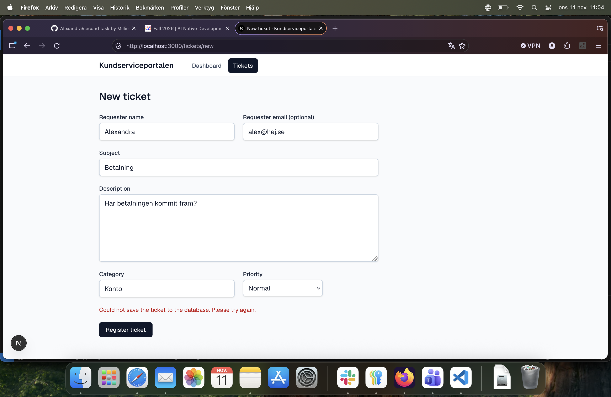
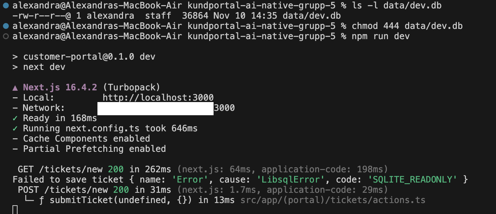

# Manual check: clear message when a ticket cannot be saved (AC1.8)

- **Date:** 2026-11-11
- **Tester:** Alexandra Petersson
- **Environment:** macOS, Firefox, VoiceOver, `npm run dev` (Next.js 16.4.2)
- **Branch:** `Alexandra/save-failure-message`
- **Database:** `data/dev.db`
- **Spec:** [save-failure-message.md](../specs/save-failure-message.md#manual-check) · **Decision:** [07](../decisions/07-save-failure-handling.md)
- **Result:** Passed

## Why this check is manual

The automated tests cover the logic (T1–T8 and mutation M4). Three things need a real browser and a person: that the message is red, that a screen reader announces it, and that focus stays where it is (R4, R7, R9). An e2e test was not used, because the e2e tests share one database and the server must be restarted around the change (decision 07).

## Steps and results

| # | Step | Expected | Result |
|---|---|---|---|
| 1 | `ls -l data/dev.db` | Note the permissions | `-rw-r--r--` (644) |
| 2 | Stop the server, then `chmod 444 data/dev.db` | The file is read-only | Done |
| 3 | `npm run dev`, open `/tickets/new`, fill in a valid ticket and click **Register ticket** | See steps 4–9 | Done |
| 4 | Look at the page | "Could not save the ticket to the database. Please try again." in red directly above **Register ticket** | Passed (figure 1) |
| 5 | Look at the address and the fields | Still `/tickets/new`, no Next.js error page, all values kept, no field marked invalid | Passed (figure 1) |
| 6 | Look at the button and focus | The button says **Register ticket** and is enabled, focus is not on the message | Passed |
| 7 | Look at the server log | `Failed to save ticket { name: 'Error', cause: 'LibsqlError', code: 'SQLITE_READONLY' }`, without the entered values | Passed (figure 2) |
| 8 | Turn on VoiceOver and click **Register ticket** again | The message is hidden while the attempt is pending and announced again when it fails | Passed |
| 9 | Stop the server, `chmod 644 data/dev.db`, start it again and register the ticket | The ticket is saved and the ticket list is shown | Passed |

## Screenshots

### Figure 1: the message in the browser

The form on `http://localhost:3000/tickets/new` after a failed save. The handler's input is kept: name "Alexandra", email "alex@hej.se", subject "Betalning", description "Har betalningen kommit fram?", category "Konto" and priority Normal. The red message "Could not save the ticket to the database. Please try again." is shown directly above **Register ticket**. No field has a red border, and the button is enabled. The data is fake.

### Figure 2: the server log

`ls -l` shows that `data/dev.db` was writable (`-rw-r--r--`) before the test. `chmod 444` makes it read-only, and `npm run dev` starts the server. After `GET /tickets/new` the server logs `Failed to save ticket { name: 'Error', cause: 'LibsqlError', code: 'SQLITE_READONLY' }`, and `POST /tickets/new` answers `200`, not an error page. The log line has no name, email or SQL (R12).

## Not covered

- Windows (`attrib +R` and `attrib -R`). Jessica Swahn will try these steps.
- Other browsers than Firefox, and other screen readers than VoiceOver.
- Other database errors than `SQLITE_READONLY` in a real browser. The automated tests cover `SQLITE_ERROR`, a missing database directory and values that are not an `Error`.
